# EC2 Inspector: the "explain it to a donkey" guide (Mac edition)

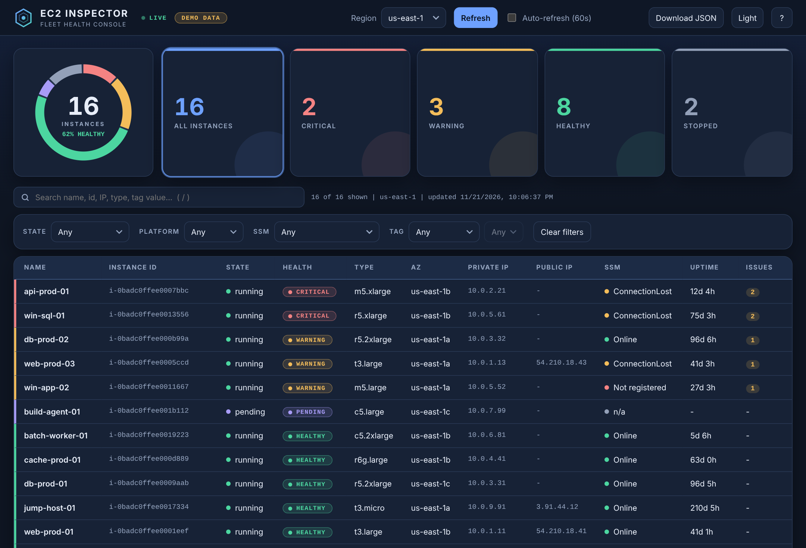

## The 30-second version

You have servers in Amazon's cloud (called **EC2 instances**). Normally, to check
whether they are healthy you click through many AWS pages, one server at a time.

**EC2 Inspector is one page that shows all your servers at once**, with a colour
badge on each: green means fine, amber means look at it soon, red means broken.
Click any server to see everything about it.

It only **looks**. It never starts, stops, changes or deletes anything.

You can try it **right now without an AWS account**: demo mode shows a made-up
fleet of 16 servers.

It has a **light and a dark theme** (it follows your Mac's appearance the first
time, and you can switch with one click):

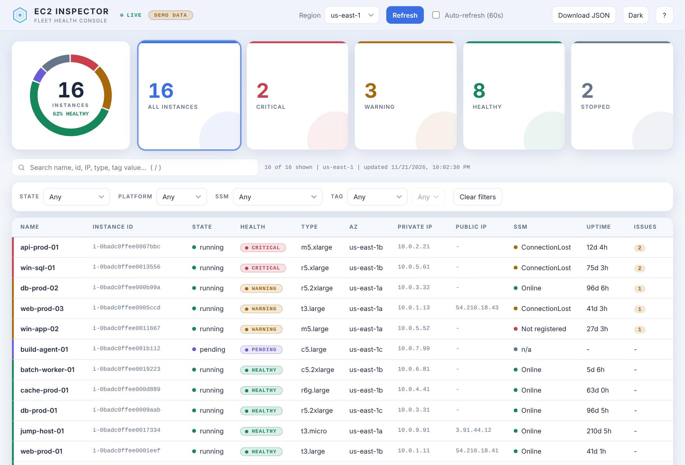

---

# Part 1. How it works

## 1.1 The restaurant story

Think of a restaurant.

| In the restaurant | In this project |
|---|---|
| You, sitting at the table | **Your browser** (Safari, Chrome...) |
| The menu and the table | **The dashboard page** (`index.html`) |
| The kitchen | **The app** (Python + FastAPI) running on your Mac |
| Three suppliers the kitchen phones | **AWS**: EC2, SSM and CloudWatch |
| A health inspector with a checklist who stamps every dish | **The health rules** (`inspector.py`) |
| A plastic display of fake food | **Demo mode** (fake servers, no AWS needed) |
| "We only look at the food, we never cook it" | **Read-only**: nothing in AWS is changed |

You ask the kitchen (the app) for a table of your servers. The kitchen phones the
three suppliers, the inspector stamps each server, and the finished table comes
back to your screen.

## 1.2 The big picture

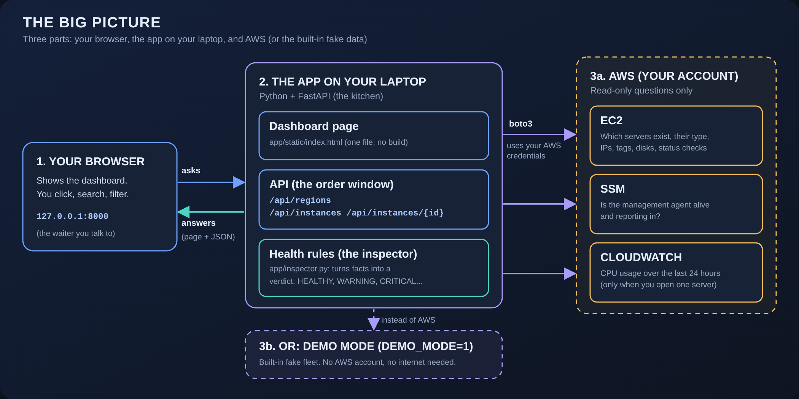

There are three parts:

1. **Your browser** shows the page and sends your clicks to the app.
2. **The app on your Mac** has three jobs: serve the page, answer questions
   (the API), and judge health (the rules).
3. **AWS** (or demo mode) is where the facts come from.

The three AWS suppliers:

| Supplier | What the app asks it |
|---|---|
| **EC2** | Which servers exist? Type, IP addresses, tags, disks, and the two AWS "status checks". |
| **SSM** (Systems Manager) | Is the management agent on each server alive and reporting in? |
| **CloudWatch** | How busy was the server's CPU over the last 24 hours? (Only when you open one server.) |

## 1.3 Step by step: what happens when you open the page

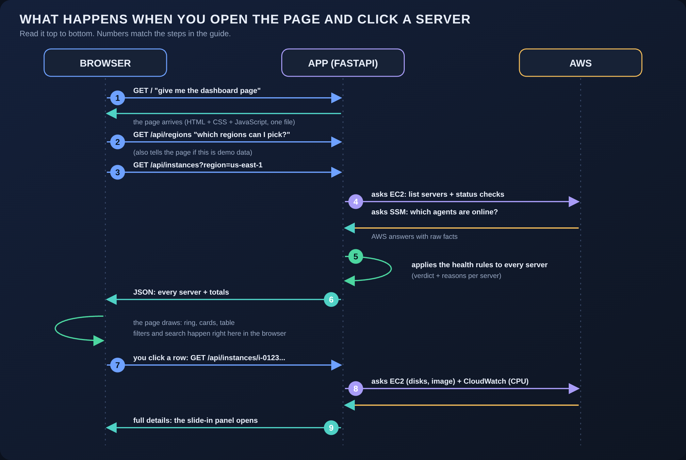

1. Your browser asks the app for the page (`GET /`). The page arrives as one file.
2. The page asks `/api/regions`: "which AWS regions can I pick?" The answer also says whether this is demo data.
3. The page asks `/api/instances?region=us-east-1`: "list the servers in this region".
4. The app phones AWS: EC2 for the servers and their status checks, and SSM for the agents.
5. The app runs the **health rules** on every server and attaches a verdict and reasons.
6. The app sends everything back as JSON. The page draws the **ring, the cards and the table**. Searching, filtering and sorting happen inside your browser, so they feel instant.
7. You click a server. The page asks `/api/instances/i-0123...`.
8. The app asks EC2 for disks and image details, and CloudWatch for CPU.
9. The full details come back and the **slide-in panel** opens.

## 1.4 How a server gets its badge

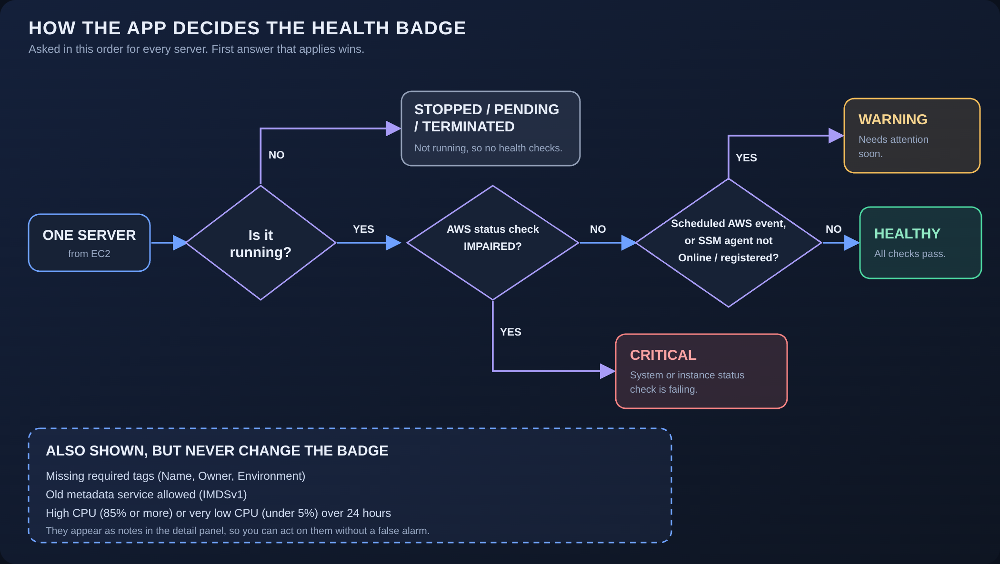

The app asks these questions in order. The first answer that applies wins.

| Question | Answer | Badge |
|---|---|---|
| Is the server running? | No: stopped / stopping | **STOPPED** |
| | No: starting up | **PENDING** |
| | No: deleted | **TERMINATED** |
| Is an AWS status check **impaired**? | Yes | **CRITICAL** |
| Is an AWS maintenance event scheduled, or is the SSM agent not Online / not registered? | Yes | **WARNING** |
| Otherwise | | **HEALTHY** |

Some things are shown as **notes** but never change the badge, so you get no
false alarms: missing tags, the old metadata service (IMDSv1) allowed, and CPU
that is very high (85% or more) or very low (under 5%) over 24 hours.

> The app never guesses. If it cannot read a source (for example you did not
> give it SSM permission), it says so in an amber banner and skips only the
> checks that need that source.

## 1.5 What is inside the folder

```
ec2-inspector/
  GUIDE.md               this guide
  README.md              short technical summary
  requirements.txt       the Python packages the app needs
  requirements-dev.txt   extra packages, only for running the tests
  iam-policy.json        the read-only AWS permissions the app needs
  Dockerfile             optional: run it in a container
  app/
    main.py              the web app and the API endpoints
    inspector.py         reads AWS and decides the health badges
    demo.py              the built-in fake fleet (demo mode)
    static/index.html    the dashboard page (look and behaviour)
  tests/                 57 automatic Python tests
  ui-tests/              optional browser-behaviour tests (need Node.js)
  docs/                  the diagrams and screenshots used in this guide
```

## 1.6 Words you will meet

| Word | Meaning |
|---|---|
| **EC2 instance** | One virtual server in AWS. |
| **Region** | A geographic AWS location, like `us-east-1`. Servers live in one region. |
| **Availability zone (AZ)** | One data centre group inside a region, like `us-east-1a`. |
| **Status checks** | Two tests AWS runs itself: the *system* check (the physical host) and the *instance* check (your operating system). |
| **SSM agent** | A small program on the server that lets AWS manage it remotely (patching, commands). |
| **CloudWatch** | AWS's measurement service. Here: CPU usage. |
| **Tag** | A label on a server, like `Owner = windows-ops`. |
| **IAM** | AWS's permission system. It decides what the app is allowed to read. |
| **API** | A set of web addresses the page uses to ask the app for data. |
| **JSON** | A plain-text data format that the API replies with. |
| **boto3** | The Python library the app uses to talk to AWS. |
| **Terminal** | The Mac app where you type commands. |
| **Virtual environment (venv)** | A private folder of Python packages for one project, so it cannot mess up other projects. |

---

# Part 2. Make it work on your Mac

There are two paths. **Path A takes about 10 minutes and needs no AWS account.**
Do Path A first. Path B connects to real AWS.

All commands below are for **Terminal** (press **Cmd + Space**, type `Terminal`,
press Return). Type or paste one command at a time and press Return.

## Before you start

You need a Mac with internet (to download Python packages once) and a reasonably
recent browser (Safari 16.2 or newer, or current Chrome, Edge or Firefox). You do
**not** need Docker, Node.js, Homebrew or any database.

### Check Python

```bash
python3 --version
```

- **Python 3.9 or newer works** for the demo. macOS usually has Python 3.9
  already, so you can start straight away.
- If macOS offers to install the "command line developer tools", click
  **Install**, wait until it finishes, then run the command again. (You can also
  start it yourself with `xcode-select --install`.)

> **For real AWS, Python 3.10 or newer is better.** The AWS library (boto3) has
> stopped supporting Python 3.9 and prints a warning there. It still works, but
> it no longer gets updates. If you use Homebrew, upgrade once:
> `brew install python@3.12`, then use `python3.12` instead of `python3` in the
> commands below. Without Homebrew, download the installer from python.org.

## Path A. Demo mode (no AWS account)

### Step A1. Unzip the project

Double-click `ec2-inspector.zip` in Finder (it is probably in **Downloads**). You get
a folder called `ec2-inspector`.

### Step A2. Open Terminal inside the folder

```bash
cd ~/Downloads/ec2-inspector
ls
```

You should see `app`, `tests`, `requirements.txt` and `GUIDE.md`. If you do not,
you are in the wrong folder (often one level too high or too low). If you moved the
folder, change the path (tip: type `cd ` and drag the folder from Finder onto the
Terminal window).

### Step A3. Create the private Python folder (virtual environment)

```bash
python3 -m venv .venv
source .venv/bin/activate
```

When it works, your prompt starts with `(.venv)`.

### Step A4. Install the packages

```bash
pip install -r requirements.txt
```

It downloads three things (boto3, fastapi, uvicorn) and their helpers. Wait for
`Successfully installed ...`. (A note saying a newer pip is available is harmless.)

### Step A5. Start the app in demo mode

```bash
DEMO_MODE=1 python -m uvicorn app.main:app --port 8000
```

You should see a line like `Uvicorn running on http://127.0.0.1:8000`.
**Leave this Terminal window open.** The app lives in it.

> If macOS asks whether "python" may accept incoming network connections, you can
> click **Deny**. The app only talks to your own Mac.

### Step A6. Open the dashboard

In a **second** Terminal window (Cmd + T opens a new tab), or just in your browser:

```bash
open http://127.0.0.1:8000
```

You should see the dashboard with a **DEMO DATA** badge and 16 servers. Click a red
row and the detail panel slides in. Done: it works.

### Step A7. Stop it

Click the Terminal window where the app is running and press **Control + C**.
Next time, you only need to repeat Steps A2, A3 (just the `source` line) and A5.

## Path B. Connect it to your real AWS account

> **Read this first.**
> - Use a **personal or practice AWS account** to learn. Do **not** point this at
>   a company or production account unless your manager and your security team
>   have said yes. The app only reads, but the server list itself (names, IP
>   addresses) is sensitive information. This matters even more in regulated
>   (GxP) environments.
> - Never paste your access keys into chats, emails, screenshots or Git.

### Step B1. Install the AWS command line tool (AWS CLI)

With Homebrew:

```bash
brew install awscli
```

Without Homebrew, download and run the installer from
`https://awscli.amazonaws.com/AWSCLIV2.pkg`.

Check it:

```bash
aws --version
```

### Step B2. Create a read-only permission (IAM policy)

1. Sign in to the AWS Console and open **IAM**.
2. Click **Policies**, then **Create policy**.
3. Choose the **JSON** tab.
4. Open the file `iam-policy.json` from the project (double-click opens it in TextEdit), copy everything, and paste it in. (It only contains "Describe" and "Get" permissions: reading, never changing.)
5. Click **Next**, name it `EC2InspectorReadOnly`, and click **Create policy**.

### Step B3. Create a user that has only that permission

1. In IAM click **Users**, then **Create user**.
2. User name: `ec2-inspector`. Leave "console access" **unticked**. Click **Next**.
3. Choose **Attach policies directly**, search for `EC2InspectorReadOnly`, tick it, click **Next**, then **Create user**.
4. Click the new user, open **Security credentials**, and click **Create access key**.
5. Choose **Command Line Interface (CLI)**, tick the confirmation box, and click **Next**, then **Create access key**.
6. You now see an **Access key ID** and a **Secret access key**. Copy both now. The secret is shown only once.

### Step B4. Give the keys to your Mac

```bash
aws configure --profile ec2inspector
```

It asks four questions. Answer:

| Question | Answer |
|---|---|
| AWS Access Key ID | paste the key ID |
| AWS Secret Access Key | paste the secret |
| Default region name | `us-east-1` (or the region where your servers are) |
| Default output format | `json` |

Now test that AWS accepts the keys:

```bash
aws sts get-caller-identity --profile ec2inspector
```

You should see your account number and a user ending in `ec2-inspector`.
If you see an error here, fix it before going on (see Troubleshooting).

> **Company accounts that use single sign-on (SSO):** instead of access keys, run
> `aws configure sso`, finish the sign-in in the browser, and use the profile name
> you created. Before each session run `aws sso login --profile <name>`.

### Step B5. Start the app against real AWS

In the project folder, activate the venv (`source .venv/bin/activate`), then:

```bash
unset DEMO_MODE
AWS_PROFILE=ec2inspector AWS_REGION=us-east-1 python -m uvicorn app.main:app --port 8000
```

Open **http://127.0.0.1:8000**. There is no DEMO DATA badge now: you are seeing
your real servers. Use the **Region** menu to look at other regions. If the page
is empty, that region simply has no servers.

### Step B6 (optional). Create two test servers so you can see all the colours

Skip this if you already have servers. **Servers cost money while they run**, so
delete them when you finish (Step B7).

First create the role that lets a server talk to SSM:

1. IAM, then **Roles**, then **Create role**. Choose **AWS service** and **EC2**, click **Next**.
2. Search for `AmazonSSMManagedInstanceCore`, tick it, click **Next**.
3. Name it `ssm-managed-instance`, click **Create role**.

Then launch the servers (EC2, then **Launch instance**):

| | Server 1 (should turn green) | Server 2 (should turn amber) |
|---|---|---|
| Name | `test-ok` | `test-no-ssm` |
| Image | Amazon Linux 2023 | Amazon Linux 2023 |
| Type | `t3.micro` | `t3.micro` |
| Key pair | Proceed without a key pair | Proceed without a key pair |
| Network | leave the defaults | leave the defaults |
| Advanced details, IAM instance profile | `ssm-managed-instance` | leave empty |
| Tags (add) | `Owner=me`, `Environment=test` | none |

Wait 3 to 5 minutes, then click **Refresh** in the dashboard (or press **R**).

- `test-ok` should be **HEALTHY** with SSM **Online**.
- `test-no-ssm` should be **WARNING** with SSM **Not registered**.
- In the EC2 console, **Stop** a third server to see **STOPPED**.

### Step B7. Clean up so you are not charged

- In EC2, select the test servers, then **Instance state**, then **Terminate instance**.
- In IAM, when you no longer need the tool, open the `ec2-inspector` user,
  **Security credentials**, and **Delete** (or Deactivate) the access key.

## Optional: run the automatic tests

```bash
pip install -r requirements-dev.txt
pytest -q
```

You should see `57 passed`. The tests use simulated AWS, so they need no account
and cost nothing.

There are also optional browser-behaviour tests (they need Node.js,
`brew install node`):

```bash
cd ui-tests
npm install
npm test
```

## Optional: run it in Docker

Install Docker Desktop for Mac, then:

```bash
docker build -t ec2-inspector .
docker run --rm -p 8000:8000 -e DEMO_MODE=1 ec2-inspector
```

Then open http://127.0.0.1:8000. (The Docker image has not been built or run
during development, so treat this as untested.)

## Troubleshooting

| What you see | Why | What to do |
|---|---|---|
| `zsh: command not found: python` | On a Mac the command is `python3` until the venv is active | Use `python3`, or activate the venv (Step A3), after which `python` works |
| `xcrun: error: invalid active developer path` or a pop-up about developer tools | Mac command line tools are missing | Run `xcode-select --install` and wait for it to finish |
| `error: externally-managed-environment` when installing | You ran `pip` outside the venv (Homebrew Python protects itself) | Activate the venv (Step A3) and run the install again |
| `No module named uvicorn` or `No module named app` | venv not active, or you are in the wrong folder | Run `source .venv/bin/activate`, then `ls` and check you can see the `app` folder |
| `Address already in use` / port 8000 busy | Something else uses the port | Use another port: `--port 8001`, then open `http://127.0.0.1:8001` (or see what uses it: `lsof -i :8000`) |
| `zsh: no matches found: http://...?verdict=...` | zsh treats `?` specially | Put the whole address in quotes: `curl "http://127.0.0.1:8000/api/instances?verdict=CRITICAL"` |
| pip fails with a certificate or proxy error | A company network or VPN is intercepting downloads | Try off the VPN, or ask IT how to set the proxy for pip |
| The page loads but is empty with a red banner "No AWS credentials found" | The app cannot find AWS keys | Do Step B4 and B5 (set `AWS_PROFILE`), or use demo mode |
| Red banner "AWS denied the request" | The policy is missing or incomplete | Re-check Step B2 and B3. The policy must include everything in `iam-policy.json` |
| Amber banner "ssm unavailable" or "cloudwatch unavailable" | Those two permissions are missing | Add them from `iam-policy.json`. The app still works without them but skips those checks |
| Regions list shows only one region | No permission to list regions | Add `ec2:DescribeRegions`. The app falls back to your default region |
| Everything is empty | Wrong region | Switch the **Region** menu |
| `aws sts get-caller-identity` fails | Wrong keys, or the wrong profile name | Run `aws configure --profile ec2inspector` again; check the profile name |
| Page asks for an "API key" | `API_KEY` is set in your Terminal | Type that key in the box, or remove the setting: `unset API_KEY` |
| The copy button says "Copy is not available" | Your browser blocked clipboard access | Click once inside the page and try again, or use Chrome or Safari |

This is what the "no credentials" message looks like:

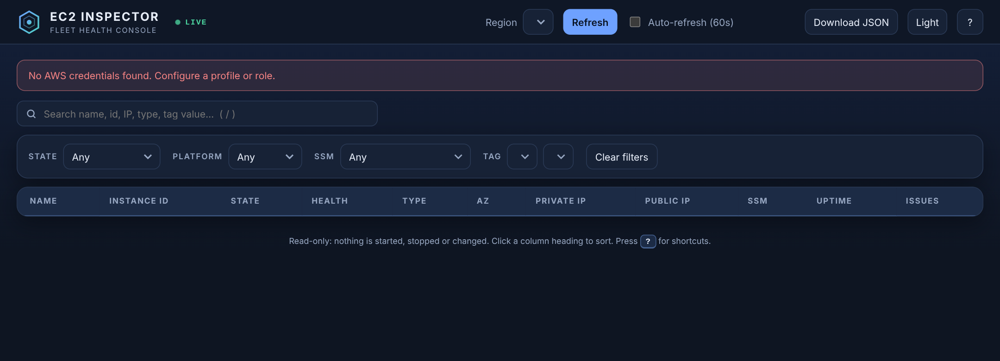

---

# Part 3. How to use it, end to end

## 3.1 A tour of the screen


From top to bottom:

1. **Header.** The name, a **LIVE** light, the **DEMO DATA** badge (only in demo mode), the **Region** menu, **Refresh**, **Auto-refresh (60s)** with a countdown, **Download JSON**, a **Light / Dark** button, and a **?** button that lists the keyboard shortcuts.
2. **The ring.** Every server is a coloured slice. The middle shows how many servers you have and what percent of the *running* ones are healthy. **Hover** a slice to see its count; **click** a slice to show only those servers (click it again to undo).
3. **The five cards.** All, Critical, Warning, Healthy, Stopped. Each shows a count. **Click a card to show only those servers.** Click **All instances** to go back.
4. **The search box.** Type part of a name, ID, IP address, instance type or any tag value.
5. **The filter bar and filter chips.** State, Platform, SSM, and a Tag picker. Every active filter also appears as a small **chip** you can remove with its ×.
6. **The table.** One row per server, worst problems first. The coloured stripe on the left edge of each row matches its health. **Click a column heading to sort.**

The table columns:

| Column | Meaning |
|---|---|
| Name | The `Name` tag |
| Instance ID | AWS's unique ID, like `i-0badc0ffee0007bbc`. A copy icon appears when you point at the row. |
| State | running, stopped, pending... |
| Health | The badge from section 1.4 |
| Type | Size of the server, like `m5.xlarge` |
| AZ | Which data centre group it is in |
| Private IP / Public IP | Its network addresses (`-` means none) |
| SSM | Online, Not online (with the reason, like ConnectionLost), Not registered, or n/a for servers that are not running |
| Uptime | How long it has been running since last start |
| Issues | How many warnings or critical problems it has |

## 3.2 Light and dark themes

The first time, the page follows your Mac's appearance (System Settings, then
Appearance). Click the **Light / Dark** button (or press **T**) to switch. Your
choice is remembered in this browser.

## 3.3 Click the ring

Point at a slice of the ring: the slice grows, the others fade, and the middle
shows that group's count and its share of your fleet. Click it to filter the
table. Click it again to clear. You can also use the keyboard: Tab to a slice and
press Enter.

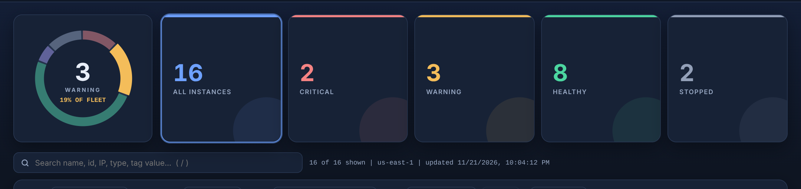

## 3.4 Filter the list

All filters combine (a server must match **every** filter you set). Filtering is
instant because the data is already in your browser. Each active filter shows up
as a chip; click the **×** on a chip to remove just that one, or press
**Clear filters** to remove all.

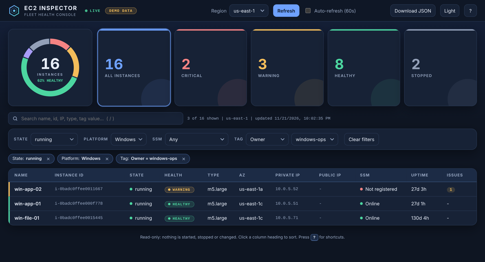

| Filter | How to use it |
|---|---|
| **Ring slices and cards** | Click Critical, Warning, Healthy or Stopped. |
| **Search box** | Type any part of a name, ID, IP, type or tag value. Press **/** to jump to it. |
| **State** | running, stopped, pending, stopping, shutting-down, terminated. |
| **Platform** | Linux or Windows. |
| **SSM** | *Online*, *Registered, not online* (agent exists but is not reporting), or *Not registered* (no agent or no permission). Servers that are not running show "n/a" and match none of these. |
| **Tag** | First choose a tag name (the list only contains tags that exist). Then choose a value, or **(not set)** to find servers that are *missing* that tag. |
| **Clear filters** | Resets everything (or press **C**). |

Show only the critical servers by clicking the Critical card or ring slice:

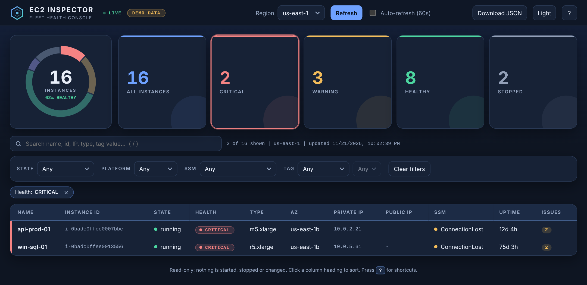

## 3.5 Sort the table

Click a column heading:

- **First click:** A to Z (or smallest to largest). A small ▲ appears.
- **Second click:** Z to A (or largest to smallest). The arrow turns ▼.
- **Third click:** back to the default order (worst problems first).

IP addresses sort the way people expect (`10.0.0.2` comes before `10.0.0.10`).
Empty values (for example the uptime of a stopped server) always go to the bottom.
Sorting works together with filters.

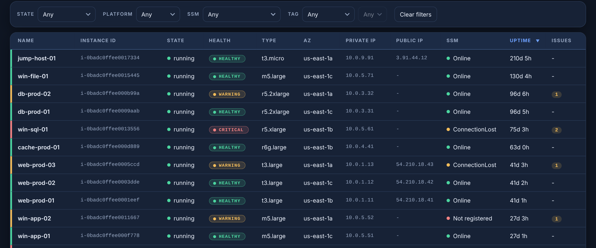

## 3.6 Row actions

- **Copy an instance ID:** point at a row and click the small copy icon next to the
  ID. A small message at the bottom confirms it.
- **Open a server:** click the row, or move to it with the keyboard and press Enter.

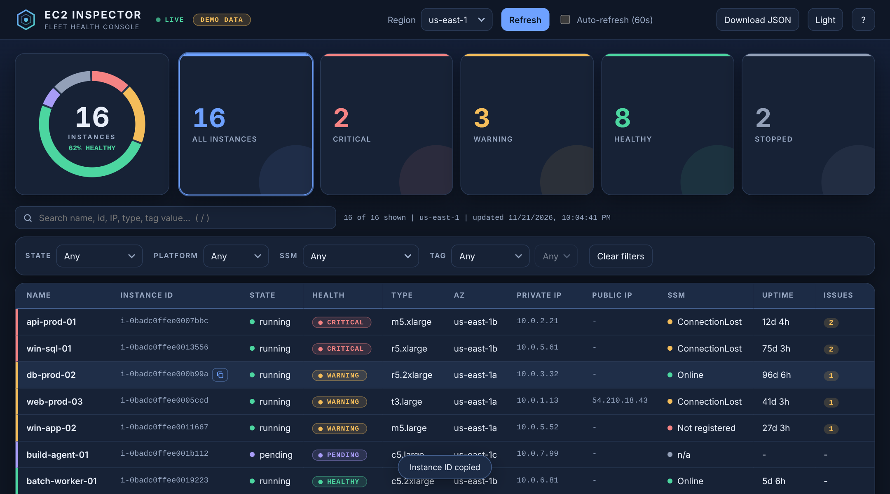

## 3.7 Look at one server in detail

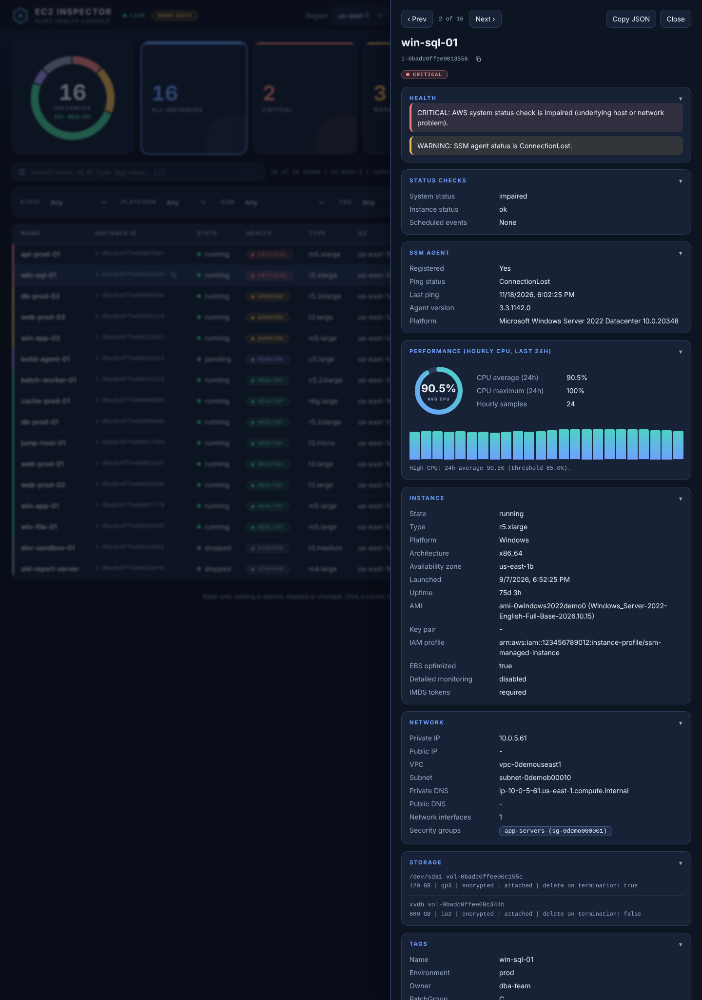

The panel slides in from the right and shows, from the top:

| Section | What it tells you |
|---|---|
| **Top bar** | **Prev / Next** to walk through the servers in your current list (the position, like "3 of 16", is shown), **Copy JSON** (everything about this server), and **Close**. |
| **Health** | The reasons for the badge, in plain words. Red = critical, amber = warning, blue = just a note. |
| **Status checks** | The two AWS checks (system and instance) and any scheduled AWS events. |
| **SSM agent** | Registered or not, last time it reported in, its version and platform. |
| **Performance** | A CPU dial with the 24-hour average and maximum, and one bar per hour (point at a bar for the exact time and value). The notes under it say "High CPU" or "Low CPU". |
| **Instance** | State, type, platform, when it started, the image (AMI), key pair, IAM role, and the metadata setting (IMDS). |
| **Network** | IP addresses, VPC, subnet, DNS names, security groups. |
| **Storage** | Every disk: size, type, whether it is **encrypted**, and whether it is deleted with the server. |
| **Tags** | All the labels on the server. |

Handy things in the panel:

- **Click a section heading** to collapse or expand it.
- **← and → keys** move to the previous or next server. The panel only walks the servers that are currently shown, so filter first if you want to review a group.
- The open server stays highlighted in the table behind.
- Close with the **Close** button, by clicking the dimmed area, or by pressing **Esc**.

A warning example (a scheduled AWS retirement, with Prev / Next at the top):

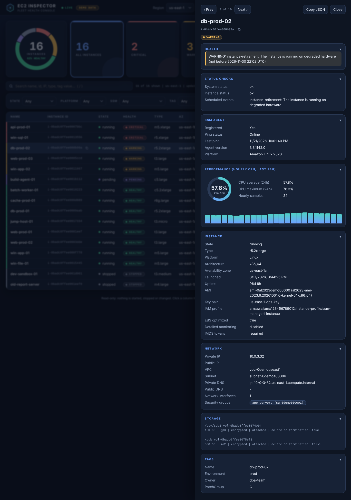

The same kind of panel in the light theme (this server only has notes, so its
badge stays green):

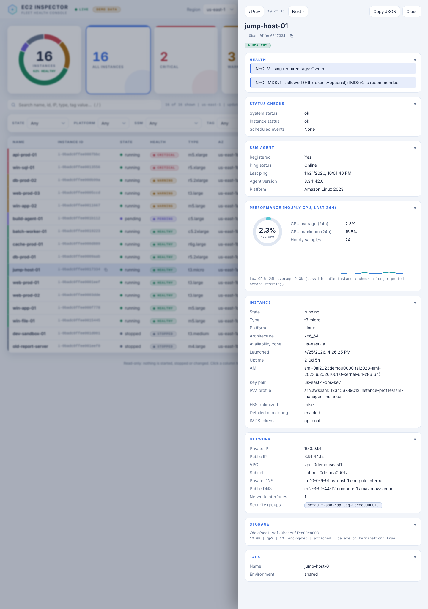

## 3.8 Keyboard shortcuts

Press **?** any time to see this list. Shortcuts are ignored while you are typing
in a box.

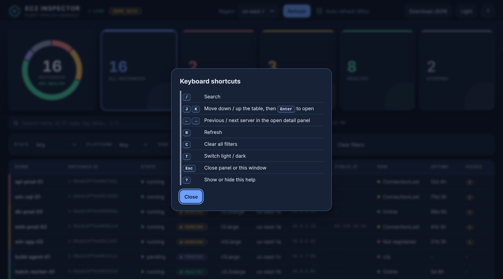

| Key | What it does |
|---|---|
| **/** | Jump to the search box |
| **J** / **K** | Move down / up the table (then **Enter** opens the server) |
| **←** / **→** | Previous / next server while the panel is open |
| **R** | Refresh |
| **C** | Clear all filters |
| **T** | Switch light / dark |
| **Esc** | Close the panel or the help window (or leave the search box) |
| **?** | Show or hide the shortcuts |

## 3.9 Share or bookmark a view

Look at the address bar. It changes as you filter and sort, for example:

```
http://127.0.0.1:8000/?region=us-east-1&platform=Windows&state=running&tagKey=Owner&tagValue=windows-ops&sort=uptime_hours:desc
```

Bookmark it to come back to the same view. **Note:** `127.0.0.1` means "this
Mac", so a colleague cannot open your link. They would need to run the app
themselves (or you would need to host it for them). To share what you see, send a
screenshot or the downloaded JSON.

## 3.10 What to do about each message

The app tells you what is wrong. These are the usual next steps. Always follow
your own change-control rules, especially in regulated environments.

| Message in the Health section | What it means | What to do |
|---|---|---|
| **System status check is impaired** | A problem with the physical host under your server | In the EC2 console, **Stop** and then **Start** the server (not just Reboot). That usually moves it to a healthy host. Be aware that stop/start can change the public IP and erases instance-store disks. |
| **Instance status check is impaired** | A problem inside the server: the operating system, disk full, network settings | In EC2, use **Monitor and troubleshoot** then **Get system log** or **Get instance screenshot**. Try to connect (RDP/SSH). A reboot often helps. |
| **Scheduled event** (for example `instance-retirement`) | AWS plans to maintain or retire the host | Plan a stop/start before the date shown (it is shown in UTC). Reboot events happen by themselves. |
| **SSM agent status is ConnectionLost** | The agent used to report but stopped | Windows servers: check the "Amazon SSM Agent" service in Services. Linux: `systemctl status amazon-ssm-agent`. Check the server can reach the internet or SSM endpoints. |
| **Not registered with SSM** | The agent never connected | The server needs the `AmazonSSMManagedInstanceCore` role, the agent installed, and a network path to SSM. |
| **Missing required tags** | The server lacks tags such as Name, Owner, Environment | Add the tags. Use the Tag filter with **(not set)** to find all such servers. |
| **IMDSv1 is allowed** | The older, weaker metadata service is on | Switch to IMDSv2-only, **after** checking your software supports it, and try it on a test server first. |
| **High CPU** note | 24-hour average is 85% or more | Look at what the workload is doing. Consider a larger size. |
| **Low CPU** note | 24-hour average is under 5% | It may be idle. Look at a longer period before shrinking or switching it off. |

## 3.11 Everyday routines

**Morning check (about 1 minute).**
1. Open the dashboard and press **R** to refresh.
2. Look at the ring and the **Critical** and **Warning** cards.
3. Click **Critical**, open the first server, read the Health section, act (3.10), then press **→** for the next one.
4. Do the same for **Warning**.

**"Which Windows servers cannot be patched through SSM?"**
1. Set **Platform = Windows**.
2. Set **SSM = Registered, not online**, read the list, then switch to **Not registered**.
3. Those are the servers that SSM cannot reach. Fix their agent, role or network.

**"Which servers are missing a tag?"**
1. In **Tag**, pick the tag name (for example `Owner`).
2. Pick **(not set)**.
3. Add the tag to each server shown.

**"Which servers have been up the longest?"** Click the **Uptime** heading twice.

**"Give me a report."** Press **Download JSON**. It saves every server in the
current region (with the health verdict and reasons for each) as a file with the
date in its name. Your on-screen filters are not applied to the download. To get
the details of just one server, open it and press **Copy JSON**.

**Keep watching.** Tick **Auto-refresh (60s)** and leave the page open. A small
countdown shows when the next refresh happens.

## 3.12 For scripts: the API

The page is just one user of a small API. You can call it yourself while the app runs.

Open **http://127.0.0.1:8000/docs** for an interactive list of every endpoint.

| Address | What it returns |
|---|---|
| `/healthz` | `ok` (no AWS calls) |
| `/api/regions` | The regions, and whether demo mode is on |
| `/api/instances?region=us-east-1` | All servers with health and totals |
| `/api/instances/{id}?region=us-east-1` | Full details for one server |

Optional filters for the list (they can be combined):

```
/api/instances?name=web                          # name contains "web"
/api/instances?state=running&state=stopped       # repeat for several
/api/instances?tag=Environment=prod&tag=Owner=x  # exact Key=Value
/api/instances?verdict=WARNING&verdict=CRITICAL  # by health verdict
```

Example (note the quotes, which zsh needs because of the `?`):

```bash
curl -s "http://127.0.0.1:8000/api/instances?verdict=CRITICAL"
```

Copy the answer to your clipboard to paste into a ticket:

```bash
curl -s "http://127.0.0.1:8000/api/instances?verdict=CRITICAL" | pbcopy
```

State and tag filters are applied by AWS itself; name and verdict filters are
applied afterwards. A wrong value (for example `state=sleeping`) returns a clear
error message.

## 3.13 Settings you can change

Set these in Terminal **before** starting the app, in front of the command, like
`DEMO_MODE=1 python -m uvicorn ...`.

| Setting | Default | What it does |
|---|---|---|
| `DEMO_MODE` | off | `1` = use the built-in fake fleet |
| `AWS_REGION` | `us-east-1` | The region the dashboard opens with |
| `AWS_PROFILE` | none | Which saved AWS login to use |
| `REQUIRED_TAGS` | `Name,Owner,Environment` | Which tags count as "required" (comma-separated) |
| `API_KEY` | off | If set, the API needs this secret; the page then asks for it |

Example: require different tags:

```bash
REQUIRED_TAGS="Name,Owner,CostCenter,PatchGroup" AWS_PROFILE=ec2inspector python -m uvicorn app.main:app --port 8000
```

---

# Part 4. How it looks

## On a phone or a small window

The layout stacks into one column.

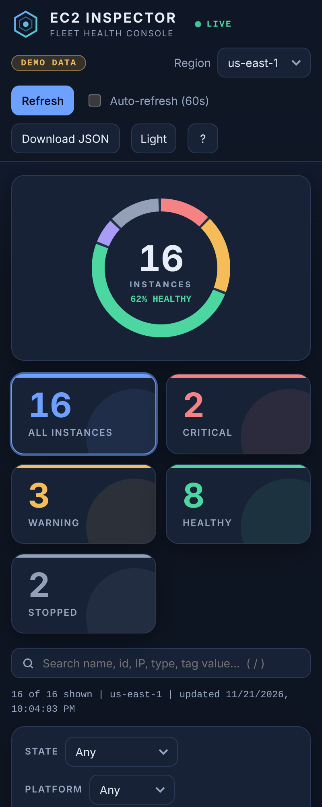

---

# Part 5. Safety, honesty and limits

**What it is safe about**
- It is **read-only**. The permission file contains only "Describe" and "Get" actions, so even if something went wrong it could not stop, start or delete a server.
- Every value from AWS (names, tags) is shown as plain text, so a hostile tag value cannot run code in your browser. Tests check this, including in the filter chips.
- If you set `API_KEY`, only people with the key can read the data.

**What to be careful about**
- The dashboard shows your server inventory. Keep it on your Mac (`127.0.0.1`), or behind an internal network. Never put it on the public internet.
- Never share or commit your AWS keys.
- On company systems, get approval first.

**What has and has not been checked**
- Checked: 57 automatic Python tests (health rules, filters, the API, demo mode, error handling), run on both Python 3.9 and 3.12; 97 browser-behaviour checks of the dashboard (filters, sorting, ring, chips, shortcuts, copy, themes, panel); and every screenshot in this guide was taken from the real running app in a headless browser.
- Not checked: it has **not** been run on an actual Mac (everything was tested on Linux, including the Python 3.9 that macOS ships), **not** against a real AWS account, and the Docker image has **not** been built. Try Path A first, then Path B with a couple of test servers, before relying on it.

**Known limits**
- No memory or disk-usage numbers. Those need the CloudWatch agent installed on the servers, which matters for Windows servers.
- One region at a time.
- Security-group rules are listed by name only, not analysed.
- The five cards and the ring show region-wide counts. The line above the table ("3 of 16 shown") shows how many your filters kept.

**Ideas for later:** a saved "watch list" of only your servers, a Windows patch-status tab using SSM patch data, and deploying it to ECS Fargate with Terraform.
