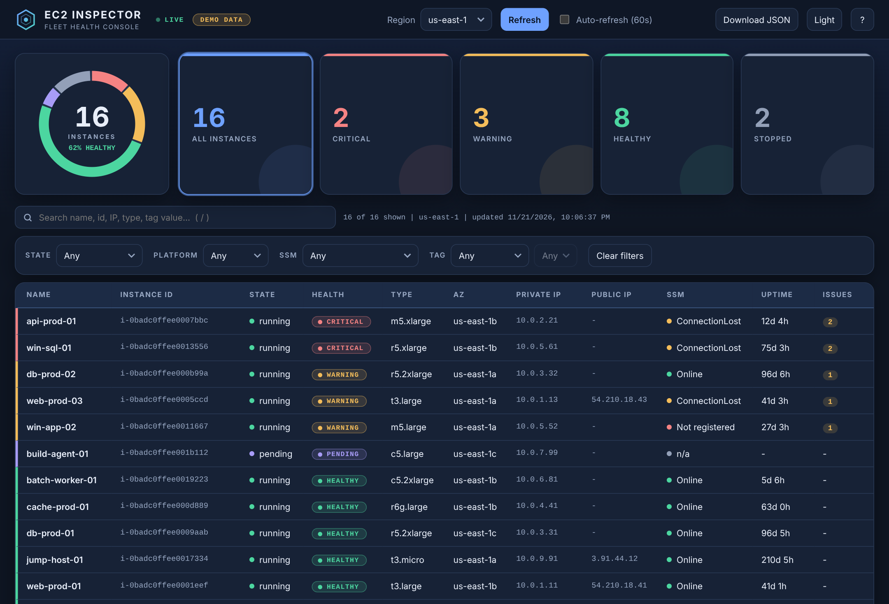

# EC2 Inspector

A small, read-only web app that lists every EC2 instance in a region with a
health verdict, and shows full details for any instance: status checks, SSM
agent, CPU, network, storage, tags.

- Backend: FastAPI + boto3 (EC2, SSM, CloudWatch)
- Frontend: one HTML file served by the backend (no build step)
- It never starts, stops or changes anything.

> **New here?** Read **GUIDE.md** (also provided as a PDF): a plain-language
> explanation, step-by-step setup for a Mac, how to use every feature, and screenshots.



## Try it in a few commands (demo mode, no AWS account)

Works with Python 3.9 or newer (the Python that macOS ships is fine).

```bash
python3 -m venv .venv && source .venv/bin/activate
pip install -r requirements.txt
DEMO_MODE=1 python -m uvicorn app.main:app --port 8000
open http://127.0.0.1:8000
```

Demo mode serves a built-in, fully synthetic fleet of 16 servers (all verdicts
and common issues) and shows a **DEMO DATA** badge. Use it to explore the
dashboard before connecting real AWS.

## Run locally against real AWS

```bash
pip install -r requirements.txt
export AWS_PROFILE=my-profile        # or any normal AWS credentials
export AWS_REGION=us-east-1
python -m uvicorn app.main:app --port 8000
# open http://127.0.0.1:8000
```

With Docker (credentials from your local AWS config, mounted read-only):

```bash
docker build -t ec2-inspector .
docker run --rm -p 8000:8000 -e AWS_PROFILE -e AWS_REGION \
  -v ~/.aws:/home/inspector/.aws:ro ec2-inspector
```

Create an IAM user or role with `iam-policy.json` (read-only). Do not use admin
credentials for this tool.

## Health verdicts

| Verdict | Meaning |
|---|---|
| CRITICAL | A running instance has an impaired AWS system or instance status check |
| WARNING | Running, but a scheduled AWS event is pending, or SSM is not Online or not registered |
| HEALTHY | Running with passing checks and no warnings |
| PENDING / STOPPED / TERMINATED | Instance lifecycle states; health checks do not apply |

Advisories (missing required tags, IMDSv1 allowed, low or high CPU) are shown in
the detail view but never change the verdict. CPU is hourly average over the
last 24 hours; an "idle" hint is only a hint, so look at a longer period before
resizing.

If a data source cannot be read (for example SSM permission is missing), the
app says so and skips only the checks that need it. It never guesses.

## Configuration

| Variable | Default | Purpose |
|---|---|---|
| `DEMO_MODE` | off | `1` = built-in synthetic fleet, no AWS needed |
| `AWS_REGION` | `us-east-1` | Default region |
| `REQUIRED_TAGS` | `Name,Owner,Environment` | Tags every instance should have |
| `API_KEY` | unset | If set, `/api/*` requires an `X-API-Key` header |

## Security notes

The app is read-only, but it reveals your instance inventory (names, IPs, IAM
profiles). Keep it on localhost or behind an internal load balancer, set
`API_KEY` if others can reach it, and never expose it to the internet.

